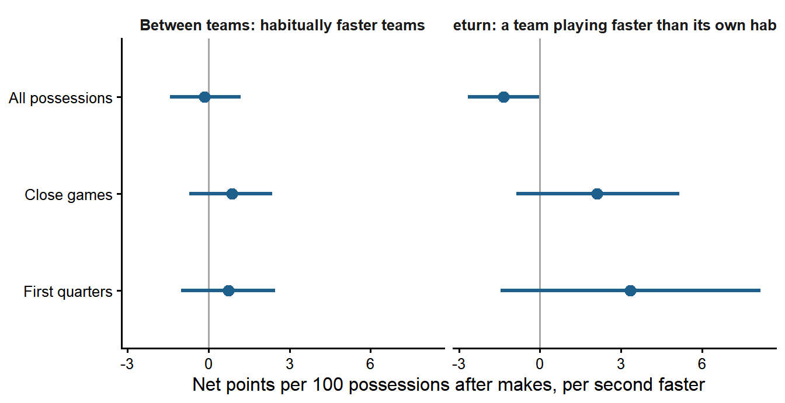

# Pushing after the opponent scores

[](https://github.com/smcostas/transition-after-makes/actions/workflows/ci.yaml)

**Report: <https://smcostas.github.io/transition-after-makes/>**

After the opponent scores, an NBA team can inbound and attack before the defense is set, or walk
the ball up. Does pushing pay, once the cost of turnovers is counted, and does it pay more for
some teams than for others?



Over all possessions, playing faster than your own habit after a made basket goes with slightly
worse possessions, consistent with teams speeding up when they are behind. In close games and
first quarters the sign flips to a small, uncertain advantage, and no team stands out from the
league value. What separates teams is the quality of these possessions, not their speed.

NBA regular seasons 2023-24 and 2024-25, about 147,000 possessions after an opponent's made field
goal. Bayesian hierarchical model in Stan (cmdstanr) with a latent, error-measured pace per
team-game.

## What is in the repository

| Page | What it has |
|---|---|
| [Report](https://smcostas.github.io/transition-after-makes/) | Results, conclusions and limitations |
| [Decision log](https://smcostas.github.io/transition-after-makes/decisions.html) | Every definition and exclusion, with the evidence behind it |
| [Model formulation](https://smcostas.github.io/transition-after-makes/formulation.html) | Notation, stochastic and deterministic components, hierarchy, priors and prior predictive check |
| [Data notes](https://smcostas.github.io/transition-after-makes/data-notes.html) | Validation of the raw sources |

```
R/          functions with tests: possessions, aggregation, model data, derived quantities
tests/      testthat tests (run by CI with lintr)
stan/       m1 (no pooling, reference) and m2 (partial pooling, main model)
scripts/    analysis, run in order in RStudio, section by section
report/     Quarto website (rendered to docs/ for GitHub Pages)
```

## Reproduce

1. Open `transition-after-makes.Rproj` in RStudio and run `renv::restore()`.
   CmdStan must be installed (`cmdstanr::install_cmdstan()`).
2. Run the scripts in order: `01_download_data.R`, `02_build_universe.R`, `03_describe.R`,
   `04_model_no_pooling.R`, `05_model_partial_pooling.R`, `06_game_state.R`. Each model fit takes
   about 15 minutes.
3. Render the site: `quarto render report`.

Tests: `testthat::test_dir("tests/testthat")`.

Data: public dumps from [shufinskiy/nba_data](https://github.com/shufinskiy/nba_data)
(pbpstats possessions and stats.nba.com play-by-play), downloaded once and not stored in the
repository.

## Credits

Santiago Costas, with Claude Opus 5.5 (high) as assistant for code, layout and writing style.

Independent analysis using public data, presented as an example case; not affiliated with the NBA
or any of its teams.
